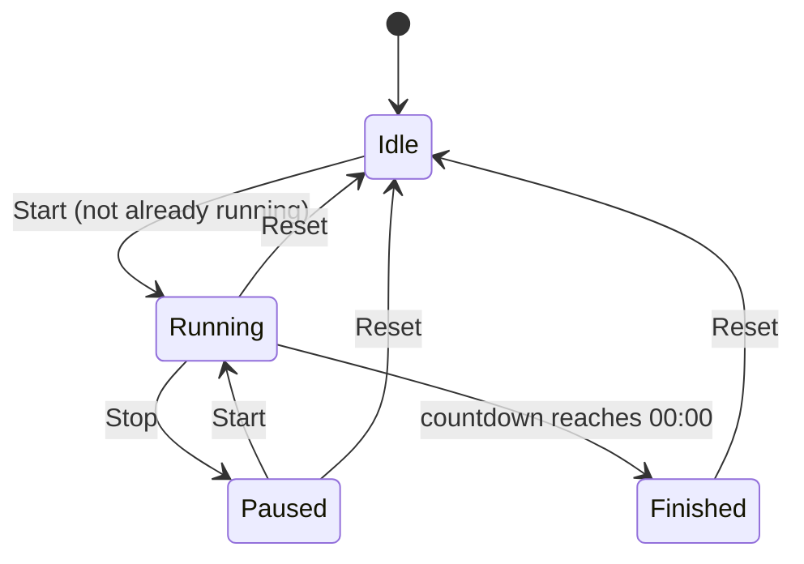

# Design Document: To-Do List Life Dashboard

## Overview

The To-Do List Life Dashboard is a zero-dependency, client-side single-page application (SPA) built with plain HTML, CSS, and Vanilla JavaScript. It runs entirely in the browser with no build step and no backend. Users can open it as a local file or serve it statically, and even set it as their browser's homepage.

The dashboard bundles six widgets into one cohesive view:

| Widget | Responsibility |
|---|---|
| Clock | Live time (HH:MM:SS) and full date |
| Greeting | Time-aware, personalised welcome message |
| Focus Timer | Pomodoro-style countdown with audible alert |
| Task List | Full CRUD to-do list with sorting |
| Quick Links | Bookmarks that open in a new tab |
| Theme Toggle | Light / dark scheme switch with no FOUC |

All persistent state is stored in `localStorage` as JSON strings. The application recovers gracefully from corrupted or missing storage data and degrades to in-memory operation when `localStorage` is entirely unavailable (e.g., private browsing with storage blocked).

---

## Architecture

### High-Level Structure

```
/
├── index.html          ← single HTML entry point
├── css/
│   └── style.css       ← all styles (variables, layout, widgets, themes)
└── js/
    └── app.js          ← all application logic
```

### Module Organisation inside `app.js`

Because the project intentionally avoids build tools and ES module bundlers, `app.js` is a single file divided into clearly delimited sections using block comments. Each section corresponds to one concern and exposes only the functions it needs to share via the single `App` namespace object attached to `window`.

```
app.js
├── StorageManager       ← localStorage read/write/error-handling
├── ClockWidget          ← time/date display, setInterval
├── GreetingWidget       ← name input, time-of-day logic
├── FocusTimerWidget     ← countdown, custom duration, audio alert
├── TaskListWidget       ← add/edit/complete/delete, sorting
├── QuickLinksWidget     ← add/delete links, open in new tab
├── ThemeManager         ← toggle, FOUC prevention, persistence
└── App.init()           ← wires everything together on DOMContentLoaded
```

### Initialisation Sequence

```mermaid
sequenceDiagram
    participant Browser
    participant ThemeManager
    participant StorageManager
    participant Widgets

    Browser->>ThemeManager: <script> tag (inline, before </head>)
    ThemeManager->>Browser: apply saved theme immediately (no FOUC)
    Browser->>Browser: parse & render DOM
    Browser->>App.init(): DOMContentLoaded
    App.init()->>StorageManager: check localStorage availability
    StorageManager-->>App.init(): available | unavailable
    alt unavailable
        App.init()->>Browser: show persistent warning banner
    end
    App.init()->>Widgets: init all widgets (restore from storage)
```

---

## Visual Layout

### Page Structure

The dashboard is a single viewport-filling page with a purple-to-indigo gradient background. All content is contained in a centered column with a maximum width. Widgets are displayed as white-background "cards" with rounded corners and a soft box-shadow.

```
┌────────────────────────────────────────────────────┐
│  BODY (gradient background)                        │
│  ┌──────────────────────────────────────────────┐  │
│  │  HEADER CARD (full width)                    │  │
│  │  ┌──────────────────────────────────────┐    │  │
│  │  │  Clock: "10:45:22"  (large, blue)    │    │  │
│  │  │  Date: "Monday, 26 May 2025"         │    │  │
│  │  │  Greeting: "Good Morning, Friend"    │    │  │
│  │  │  [Name input]  [Save]                │    │  │
│  │  └──────────────────────────────────────┘    │  │
│  │                                              │  │
│  │  MAIN GRID (2 columns)                       │  │
│  │  ┌────────────────┐  ┌────────────────────┐  │  │
│  │  │ FOCUS TIMER    │  │ TASKS              │  │  │
│  │  │ "25:00" (blue) │  │ [input] [Add]      │  │  │
│  │  │ [Start][Stop]  │  │ ☐ Task 1  [Delete] │  │  │
│  │  │ [Reset]        │  │ ☐ Task 2  [Delete] │  │  │
│  │  │ [Duration] [✓] │  │ Sort: [▼]          │  │  │
│  │  └────────────────┘  └────────────────────┘  │  │
│  │                                              │  │
│  │  QUICK LINKS CARD (full width)               │  │
│  │  [Link name] [URL] [Add Link]                │  │
│  │  [Google ×]  [GitHub ×]  …                   │  │
│  │                                              │  │
│  │  [☀/🌙 Theme toggle]  (fixed or in footer)   │  │
│  └──────────────────────────────────────────────┘  │
└────────────────────────────────────────────────────┘
```

### CSS Architecture

`css/style.css` is divided into logical sections:

```
style.css
├── 1. CSS Custom Properties (variables)
│     :root { --color-accent, --color-bg, --color-card, --color-text, … }
│     :root[data-theme="dark"] { … overrides … }
├── 2. Reset / Base styles
├── 3. Layout
│     .dashboard-container   (max-width wrapper, padding)
│     .header-card           (full-width top card)
│     .main-grid             (CSS Grid, 2 equal columns, gap, responsive)
│     .full-width-card       (spans both columns)
├── 4. Widget styles
│     .clock-display         (large font, accent color)
│     .greeting-text         (bold, primary text color)
│     .timer-display         (large font, accent color)
│     .timer-controls        (flex row, button group)
│     .task-list             (ul, no bullets)
│     .task-item             (flex row, checkbox, text, actions)
│     .task-item--completed  (strikethrough on text)
│     .quick-links-list      (flex wrap, button badges)
│     .quick-link-btn        (accent background, label + × button)
├── 5. Form controls
│     input, button           (base styles)
│     .btn-primary            (blue/indigo accent)
│     .btn-danger             (red, delete actions)
│     .btn-secondary          (grey, Stop/Reset)
│     .validation-error       (red inline messages)
├── 6. Theme toggle
│     .theme-toggle           (icon button, top-right fixed or header)
└── 7. Responsive overrides
      @media (max-width: 640px) { .main-grid → 1 column }
```

**CSS Custom Properties (light theme defaults):**

| Variable | Value | Usage |
|---|---|---|
| `--color-bg-page` | `linear-gradient(135deg, #667eea 0%, #764ba2 100%)` | Page background |
| `--color-card` | `#ffffff` | Card background |
| `--color-accent` | `#5c6bc0` | Clock, timer display, primary buttons |
| `--color-text-primary` | `#1a202c` | Body text |
| `--color-text-secondary` | `#718096` | Secondary / muted text |
| `--color-danger` | `#e53e3e` | Delete buttons, error messages |
| `--color-border` | `#e2e8f0` | Card borders, input borders |
| `--radius-card` | `12px` | Card border-radius |
| `--shadow-card` | `0 4px 20px rgba(0,0,0,0.12)` | Card box-shadow |

**Dark theme overrides (`:root[data-theme="dark"]`):**

| Variable | Dark value |
|---|---|
| `--color-card` | `#1e2432` |
| `--color-text-primary` | `#e2e8f0` |
| `--color-text-secondary` | `#a0aec0` |
| `--color-border` | `#2d3748` |

The page gradient background intentionally remains the same in both themes — only card and text colours change.

### Responsive Behaviour

- **≥ 641 px**: 2-column main grid (Focus Timer left, Tasks right).
- **≤ 640 px**: single-column stack (header → timer → tasks → quick links).
- All cards have horizontal padding so text does not touch card edges on small screens.

---

## Components and Interfaces

### StorageManager

Wraps every `localStorage` call so the rest of the codebase never touches the API directly.

```js
StorageManager.get(key)          // → parsed value | null
StorageManager.set(key, value)   // → true | false (false = write failed)
StorageManager.isAvailable()     // → boolean
```

- `get` catches `JSON.parse` errors and returns `null` on corruption.
- `set` catches `QuotaExceededError` and other storage exceptions.
- Both functions emit a custom DOM event `storage-error` on failure so widgets can surface error messages without coupling to `StorageManager` internals.

**localStorage keys:**

| Key | Value type |
|---|---|
| `dashboard_username` | `string` |
| `dashboard_tasks` | `Task[]` (JSON) |
| `dashboard_links` | `QuickLink[]` (JSON) |
| `dashboard_theme` | `"light"` \| `"dark"` |
| `dashboard_sort` | `SortMode` string |
| `dashboard_timer_duration` | `number` (minutes) |

---

### ClockWidget

```js
ClockWidget.init(containerEl)
```

- Calls `new Date()` on every tick.
- Uses `setInterval(tick, 1000)` started immediately on `init`.
- Formats time with zero-padding via a small `pad2(n)` helper (no `Intl` dependency needed for HH:MM:SS).
- Formats date using `Date` getters for full day/month names (`['Monday','Tuesday',…]` / `['January','February',…]` lookup arrays) to avoid locale inconsistencies.
- On `Date` access failure (system clock unavailable), renders an error message in the container.

---

### GreetingWidget

```js
GreetingWidget.init(containerEl)
GreetingWidget.updateName(name)   // called internally after save
```

Time-of-day thresholds (hour in 24h):

| Range | Message prefix |
|---|---|
| 05–11 | Good Morning |
| 12–17 | Good Afternoon |
| 18–21 | Good Evening |
| 22–04 | Good Night |

- On load, reads `dashboard_username` from `StorageManager`; defaults to `"Friend"`.
- Name input + save button; persists on submit; updates greeting within 100 ms.
- Displays save-failure error if `StorageManager.set` returns `false`.

---

### FocusTimerWidget

```js
FocusTimerWidget.init(containerEl)
```

Internal state machine:



Key behaviours:
- Default duration: 25 minutes.
- Custom duration validated as integer in [1, 120]; out-of-range input is rejected with an inline error.
- Timer uses `setInterval(tick, 1000)`; on Start a new interval is created; on Stop the interval is cleared.
- At `00:00`: interval cleared, completion indicator shown for ≥ 3 seconds, `AudioContext` beep played (Web Audio API, no external audio file).
- Duplicate Start guard: if state is already `Running`, Start is a no-op.
- Duration persisted via `StorageManager.set('dashboard_timer_duration', minutes)`.

---

### TaskListWidget

```js
TaskListWidget.init(containerEl)
```

**Add flow:**
1. Trim input value.
2. Reject if empty/whitespace-only → inline error.
3. Reject if length > 200 → inline error.
4. Reject if case-insensitive duplicate of any *incomplete* task → inline warning.
5. Create `Task` object, push to array, re-render, persist.

**Edit flow:**
1. Replace task row with `<input>` pre-filled with current text (max 500 chars).
2. On confirm: trim → reject if empty (retain original, no persist) → update text, re-render, persist.
3. On cancel: discard, re-render.

**Sort:** applied at render time; the underlying array always keeps insertion order. Sort preference persisted; default is `"creation"`.

**Render:** iterates the sorted view array and generates DOM nodes dynamically.

---

### QuickLinksWidget

```js
QuickLinksWidget.init(containerEl)
```

**Validation on add:**
1. Label: 1–50 chars, non-whitespace-only.
2. URL: must start with `http://` or `https://`; max 2048 chars.
3. Duplicate URL: case-insensitive comparison against existing links → inline warning.

**Open:** `window.open(url, '_blank', 'noopener,noreferrer')` (security best practice).

---

### ThemeManager

```js
// Inline script before </head> — runs synchronously before first paint
ThemeManager.applyInitial()

// Called by toggle control
ThemeManager.toggle()
```

- Applies theme by toggling a `data-theme="dark"` attribute on `<html>`.
- CSS uses `:root[data-theme="dark"]` custom property overrides.
- `applyInitial()` is an inline `<script>` block placed before `</head>` so the theme is applied before any painting occurs, preventing FOUC.
- Toggle persists to `localStorage` directly (not via `StorageManager`) in the inline script to avoid a dependency on the module loading order.

---

## Data Models

### Task

```js
/**
 * @typedef {Object} Task
 * @property {string} id          - UUID generated via crypto.randomUUID() or Date.now() fallback
 * @property {string} text        - Task description (1–200 chars for new; up to 500 on edit)
 * @property {boolean} completed  - Completion state
 * @property {number} createdAt   - Unix timestamp (ms) for sort tie-breaking
 */
```

Example JSON in `localStorage`:
```json
[
  { "id": "abc123", "text": "Buy groceries", "completed": false, "createdAt": 1716710400000 },
  { "id": "def456", "text": "Read chapter 3", "completed": true,  "createdAt": 1716710500000 }
]
```

---

### QuickLink

```js
/**
 * @typedef {Object} QuickLink
 * @property {string} id    - UUID
 * @property {string} label - Display text (1–50 chars)
 * @property {string} url   - Absolute URL starting with http:// or https:// (max 2048 chars)
 */
```

---

### SortMode

```js
/**
 * @typedef {"creation" | "active-first" | "completed-first" | "alpha-asc"} SortMode
 */
```

Sort logic summary:

| SortMode | Primary key | Secondary key |
|---|---|---|
| `"creation"` | `createdAt` asc | — |
| `"active-first"` | `completed` asc (false < true) | `createdAt` asc |
| `"completed-first"` | `completed` desc (true > false) | `createdAt` asc |
| `"alpha-asc"` | `text.toLowerCase()` asc | `createdAt` asc |

---

### AppState (in-memory, not persisted as a whole)

```js
const AppState = {
  userName: 'Friend',        // string
  tasks: [],                 // Task[]
  links: [],                 // QuickLink[]
  theme: 'light',            // 'light' | 'dark'
  sortMode: 'creation',      // SortMode
  timerDuration: 25,         // number (minutes)
  storageAvailable: true,    // boolean
};
```

---

## Correctness Properties

*A property is a characteristic or behavior that should hold true across all valid executions of a system — essentially, a formal statement about what the system should do. Properties serve as the bridge between human-readable specifications and machine-verifiable correctness guarantees.*

### Property 1: Task addition grows the list

*For any* task list and any valid task description (1–200 non-whitespace-only characters), adding the task to the list SHALL result in the list length increasing by exactly one, and the new task SHALL appear at the end of the list.

**Validates: Requirements 4.1**

---

### Property 2: Whitespace and empty descriptions are always rejected

*For any* string composed entirely of whitespace characters (including the empty string), submitting it as a task description SHALL leave the task list unchanged and the task count SHALL remain the same.

**Validates: Requirements 4.2**

---

### Property 3: Duplicate task detection is case-insensitive

*For any* task list containing at least one incomplete task with text T, submitting any string S such that `S.trim().toLowerCase() === T.text.trim().toLowerCase()` SHALL be rejected and leave the task list unchanged.

**Validates: Requirements 4.4**

---

### Property 4: Task persistence round-trip

*For any* collection of tasks, serialising the collection to JSON and then deserialising it SHALL produce an array of tasks that are structurally equal to the originals — same `id`, `text`, `completed`, and `createdAt` for each element in the same order.

**Validates: Requirements 4.6, 9.2**

---

### Property 5: Completion toggle is a round-trip

*For any* task, toggling its completion state twice (complete then uncomplete, or uncomplete then complete) SHALL return the task to its original `completed` value. No other task in the list SHALL be affected.

**Validates: Requirements 5.5, 5.6**

---

### Property 6: Sort by creation date produces non-decreasing timestamps

*For any* task list sorted by `"creation"`, every task at index `i` SHALL have a `createdAt` value less than or equal to the `createdAt` of the task at index `i+1`.

**Validates: Requirements 6.1**

---

### Property 7: Active-first sort places all incomplete tasks before all completed tasks

*For any* task list sorted by `"active-first"`, all tasks where `completed === false` SHALL appear before all tasks where `completed === true`, and within each group tasks SHALL be ordered by `createdAt` ascending.

**Validates: Requirements 6.2**

---

### Property 8: Completed-first sort places all completed tasks before all incomplete tasks

*For any* task list sorted by `"completed-first"`, all tasks where `completed === true` SHALL appear before all tasks where `completed === false`, and within each group tasks SHALL be ordered by `createdAt` ascending.

**Validates: Requirements 6.3**

---

### Property 9: Alphabetical sort is case-insensitive with createdAt tie-break

*For any* task list sorted by `"alpha-asc"`, for every pair of adjacent tasks at indices `i` and `i+1`:
- `task[i].text.toLowerCase() ≤ task[i+1].text.toLowerCase()`, and
- when `task[i].text.toLowerCase() === task[i+1].text.toLowerCase()`, then `task[i].createdAt ≤ task[i+1].createdAt`.

**Validates: Requirements 6.4**

---

### Property 10: Focus timer duration validation accepts exactly [1, 120]

*For any* integer value `d`, setting the Focus Timer duration SHALL accept it if and only if `1 ≤ d ≤ 120`. Any value outside this range SHALL be rejected, and the previously configured duration SHALL be retained unchanged.

**Validates: Requirements 3.7, 3.8**

---

### Property 11: Quick link URL validation accepts only absolute http/https URLs within length limit

*For any* string `u`, adding it as a Quick Link URL SHALL succeed if and only if `u` starts with `http://` or `https://` AND `u.length ≤ 2048`. Any string failing either condition SHALL be rejected and the link list SHALL remain unchanged.

**Validates: Requirements 7.1, 7.2**

---

### Property 12: Duplicate Quick Link detection is case-insensitive

*For any* link list containing a link with URL `U`, submitting any string `V` such that `V.toLowerCase() === U.toLowerCase()` as a new Quick Link URL SHALL be rejected and the link list SHALL remain unchanged.

**Validates: Requirements 7.9**

---

### Property 13: Greeting message prefix covers all 24 hours without overlap or gap

*For any* hour `h` in [0, 23], the `getGreetingPrefix(h)` function SHALL return exactly one of the following, with no hour mapping to two prefixes and no hour returning an unrecognised value:
- `"Good Morning"` when `5 ≤ h ≤ 11`
- `"Good Afternoon"` when `12 ≤ h ≤ 17`
- `"Good Evening"` when `18 ≤ h ≤ 21`
- `"Good Night"` when `h ≥ 22` or `h ≤ 4`

**Validates: Requirements 2.1, 2.2, 2.3, 2.4**

---

### Property 14: Username persistence round-trip

*For any* non-empty username string, saving it via `StorageManager.set('dashboard_username', name)` and then reading it back via `StorageManager.get('dashboard_username')` SHALL return a string equal to the original.

**Validates: Requirements 2.6, 2.7**

---

### Property 15: Theme toggle is a round-trip

*For any* current theme value `T ∈ {"light", "dark"}`, activating the toggle once SHALL produce the opposite theme `T'`, and activating it a second time SHALL restore `T`. The value stored in `localStorage` SHALL always equal the currently applied theme attribute on `<html>`.

**Validates: Requirements 8.2, 8.3**

---

### Property 16: localStorage corruption recovery returns default and does not throw

*For any* `localStorage` key managed by the dashboard, if the stored value is not valid JSON or does not conform to the expected schema for that key, `StorageManager.get(key)` SHALL return `null` (not throw), and the corresponding widget SHALL load its built-in default value without producing a JavaScript console error.

**Validates: Requirements 9.7, 10.3**

---

## Error Handling

| Scenario | Widget/Component | Behaviour |
|---|---|---|
| System clock unavailable | ClockWidget | Render "Time unavailable" message inside clock container |
| localStorage unavailable on load | StorageManager / App.init | Show non-dismissible warning banner; continue with in-memory defaults |
| localStorage write fails | StorageManager (event) | Widget that triggered write shows inline error message |
| Corrupted localStorage value | StorageManager.get | Return `null`; widget loads default; no console error |
| Empty/whitespace task input | TaskListWidget | Retain input focus; show inline validation message |
| Task text > 200 chars | TaskListWidget | Show inline length error; reject add |
| Duplicate task (add) | TaskListWidget | Show inline duplicate warning; reject add |
| Edit confirmed with empty text | TaskListWidget | Discard edit; retain original text; no persist |
| Timer duration out of range | FocusTimerWidget | Show inline range error; retain previous duration |
| Invalid Quick Link URL | QuickLinksWidget | Show inline format error; reject add |
| Duplicate Quick Link URL | QuickLinksWidget | Show inline duplicate warning; reject add |
| Empty/whitespace link label | QuickLinksWidget | Show inline validation error; reject add |
| Username save fails | GreetingWidget | Show inline error; retain previously displayed name |

All inline error messages are rendered as `role="alert"` elements for accessibility.

---

## Testing Strategy

### Dual Testing Approach

Unit tests cover concrete examples, edge cases, and error conditions. Property-based tests verify universal invariants across a wide input space. Both are complementary.

### Property-Based Testing Library

Use **fast-check** (`npm install --save-dev fast-check`) for property-based tests. Since the project uses no build tools in production, tests run via **Node.js** with the logic extracted into testable pure functions. Each widget's pure logic (validation, sorting, serialisation, greeting) is written as importable functions so they can be tested in isolation.

Minimum **100 iterations** per property test.

Each property test is tagged with a comment in the format:
```js
// Feature: todo-life-dashboard, Property N: <property text>
```

### Pure Functions to Extract for Testing

The following pure functions in `app.js` must be extractable (exported in a test build or via a module pattern) to enable unit and property tests:

| Function | Tests |
|---|---|
| `getGreetingPrefix(hour)` | Property 13 |
| `isValidDuration(d)` | Property 10 |
| `validateTaskText(text, existingTasks)` | Properties 1, 2, 3 |
| `sortTasks(tasks, mode)` | Properties 6, 7, 8, 9 |
| `isValidUrl(url)` | Property 11 |
| `isDuplicateUrl(url, links)` | Property 12 |
| `serializeTasks(tasks)` / `deserializeTasks(json)` | Property 4 |
| `StorageManager.get(key)` / `StorageManager.set(key, val)` | Properties 14, 16 |
| `toggleCompletion(task)` | Property 5 |
| `toggleTheme(current)` | Property 15 |

### Unit Tests

Focus on:
- Specific boundary values (length 0, 1, 200, 201, 500, 501 for task text; 0, 1, 120, 121 for timer duration)
- Each error path in `StorageManager` (unavailable, `QuotaExceededError`, JSON parse failure)
- Timer state machine transitions (Idle → Running → Paused → Running → Idle, Idle → Running → Finished)
- Default states (theme defaults to light, sort defaults to "creation", timer defaults to 25 min, name defaults to "Friend")
- Quick Link form validation edge cases (missing protocol, URL exactly 2048 chars, URL 2049 chars)

### Property Tests

One property-based test per correctness property. Key generators:

| Generator | Used for |
|---|---|
| `fc.string()` | Arbitrary task text, link labels, usernames |
| `fc.string().filter(s => s.trim() === '')` | Whitespace-only strings |
| `fc.string(1, 200).filter(s => s.trim().length > 0)` | Valid task descriptions |
| `fc.integer({ min: 0, max: 23 })` | Hour values for greeting (Property 13) |
| `fc.integer()` | Timer duration candidates (Property 10) |
| `fc.array(taskArb)` | Task lists of varying length |
| `fc.constantFrom('light', 'dark')` | Theme values (Property 15) |
| Custom `taskArb` | Task objects with `id`, `text`, `completed`, `createdAt` |
| Custom `linkArb` | QuickLink objects with `id`, `label`, `url` |

### Accessibility Testing

- All interactive controls must be reachable and operable via keyboard (Tab, Enter, Space).
- All inline error and validation messages use `role="alert"` to announce changes to screen readers.
- Theme toggle and timer buttons include `aria-label` or visible text labels.
- Checkboxes for task completion use native `<input type="checkbox">` with associated `<label>`.
- The persistent warning banner (localStorage unavailable) uses `role="alert"` and `aria-live="assertive"`.
- Manual testing with a screen reader is recommended; automated tooling (axe-core) can catch structural issues.

> Note: Full WCAG compliance validation requires manual testing with assistive technologies and expert accessibility review beyond what automated tools can verify.
